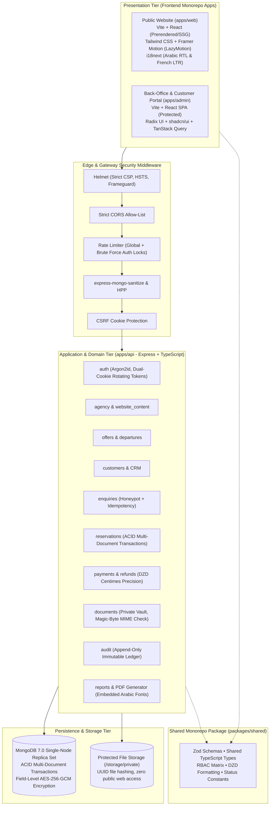
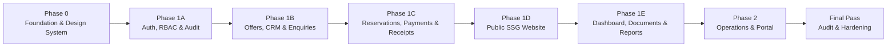

# Master Implementation Plan: Algerian Travel Agency Platform

This document establishes the authoritative technical blueprint, architecture, data schemas, access controls, API contracts, design system, and phased delivery plan for the **Algerian Travel Agency Platform**. It directly implements the functional requirements from [`spec.pdf`](file:///home/shito/travel_agency/docs/spec.pdf) and strictly enforces the foundational project rules ([`00-project.md`](file:///home/shito/travel_agency/.agents/rules/00-project.md), [`01-security.md`](file:///home/shito/travel_agency/.agents/rules/01-security.md), [`02-business-rules.md`](file:///home/shito/travel_agency/.agents/rules/02-business-rules.md), [`03-performance.md`](file:///home/shito/travel_agency/.agents/rules/03-performance.md), [`04-design.md`](file:///home/shito/travel_agency/.agents/rules/04-design.md)).

---

## 1. System Architecture



### 1.1 Architectural Guarantees & Tech Stack Alignment

- **Runtime & Language**: Node.js 20 LTS with TypeScript in strict mode (`"strict": true`, `"noImplicitAny": true`, `"exactOptionalPropertyTypes": true`).
- **Database & ACID Compliance**: MongoDB 7.0 deployed as a single-node replica set (`rs0`) in Docker Compose to enable native multi-document ACID transactions (`session.withTransaction()`). Mongoose 8+ ODM with strict schemas, validators, and compound indexes.
- **Backend Architecture**: Domain-driven modular monolith (`apps/api/src/modules/*`). Controllers are thin HTTP adapters; business logic is encapsulated in isolated services; queries use lean projections; errors flow through a centralized, error-scrubbing middleware pipeline.
- **Frontend Strategy**:
  - `apps/web`: Public-facing website using React 18, Vite, and SSG/prerendering (`vite-react-ssg`) for instantaneous LCP (< 2.5s) on mobile 4G networks and complete SEO indexability.
  - `apps/admin`: Back-office administration SPA and token-authenticated customer portal with client-side routing, optimistic mutations via TanStack Query, and keyboard-accessible Radix primitives.
- **Logging & Observability**: Structured JSON logging with `pino`. Absolute redacting of credentials, authorization headers, credit cards, bank account details, and traveller identification.
- **Testing & Verification**: Vitest unit/integration testing with `mongodb-memory-server` in replica set mode; Playwright for cross-browser E2E testing (Arabic RTL and French LTR).

---

## 2. Monorepo Folder Structure

```
travel_agency/
├── .agents/
│   └── rules/                           # Workspace rules (security, business, performance, design)
├── .env.example                         # Environment template with strict Zod validation
├── docker-compose.yml                   # MongoDB 7.0 replica set + storage volumes
├── mongo-init.sh                        # Replica set initialization script (rs.initiate())
├── package.json                         # Root monorepo workspace configuration
├── pnpm-workspace.yaml                  # pnpm workspace definition
├── tsconfig.base.json                   # Shared TypeScript base configuration
├── docs/
│   ├── spec.pdf                         # Source of truth specification
│   ├── PROGRESS.md                      # Progress tracker and decision register
│   └── PLAN.md                          # Final approved implementation plan (saved post-approval)
├── packages/
│   └── shared/                          # Isomorphic shared package (front & back)
│       ├── package.json
│       ├── tsconfig.json
│       └── src/
│           ├── index.ts
│           ├── constants/               # Currencies, roles, permissions, wilayas, status enums
│           ├── schemas/                 # Shared Zod schemas (auth, offers, reservations, payments)
│           ├── types/                   # Shared TypeScript interfaces & DTOs
│           └── utils/                   # Money formatting (centimes to DA), date utilities, slugifiers
├── apps/
│   ├── api/                             # Express REST API application
│   │   ├── package.json
│   │   ├── tsconfig.json
│   │   ├── src/
│   │   │   ├── server.ts                # HTTP server bootstrap and graceful shutdown
│   │   │   ├── app.ts                   # Express application setup and middleware pipeline
│   │   │   ├── config/                  # Zod-validated environment config schema
│   │   │   ├── database/                # Mongoose connection, replica set checks, counter helper
│   │   │   ├── middleware/              # auth, rbac, rateLimit, validate, mongoSanitize, errorHandler
│   │   │   ├── modules/                 # Domain-driven backend modules:
│   │   │   │   ├── auth/                # Argon2id, dual-cookie token rotation, password reset
│   │   │   │   ├── agency/              # Agency profile, branding CSS variables, branch registry
│   │   │   │   ├── website_content/     # CMS pages, FAQ, services, destinations
│   │   │   │   ├── offers/              # Travel packages, itineraries, departures, capacity checks
│   │   │   │   ├── customers/           # CRM, traveller vault, duplicate detection
│   │   │   │   ├── enquiries/           # Inbound requests, honeypots, idempotency, activity timeline
│   │   │   │   ├── reservations/        # Price snapshot, atomic references, transaction booking
│   │   │   │   ├── payments/            # DZD centimes tracking, balance calculation, receipt generator
│   │   │   │   ├── documents/           # Private storage, magic-byte MIME checking, access streaming
│   │   │   │   ├── notifications/       # In-app alerts, email queue, WhatsApp click-to-chat links
│   │   │   │   └── reports/             # Financial & operational summaries, PDF/CSV generators
│   │   │   └── utils/                   # Encryption (AES-256-GCM), PDF generator, sharp image pipeline
│   │   └── tests/                       # Vitest integration tests (MongoMemoryReplSet)
│   ├── web/                             # Public SSG / Vite React website
│   │   ├── package.json
│   │   ├── vite.config.ts
│   │   ├── tailwind.config.ts
│   │   └── src/
│   │       ├── main.tsx
│   │       ├── i18n/                    # Arabic and French translations
│   │       ├── components/              # AlgeriaMapSvg, StickyMobileBar, OfferCard, ItineraryViewer
│   │       ├── pages/                   # Home, About, Offers, OfferDetail, Services, Contact, FAQ, Legal
│   │       └── lib/                     # API client, local form draft recovery, SEO meta generators
│   └── admin/                           # Back-Office SPA & Customer Portal
│       ├── package.json
│       ├── vite.config.ts
│       ├── tailwind.config.ts
│       └── src/
│           ├── main.tsx
│           ├── routes/                  # Dashboard, Offers, Customers, Reservations, Payments, Portal
│           ├── components/              # CommandPalette (Ctrl+K), DataTable, StatusBadge, Timeline
│           ├── hooks/                   # useAuth, usePermission, useDataTable, useDebounce
│           └── lib/                     # TanStack Query client, API client, receipt print utility
```

---

## 3. Complete Data Model (All 22 Entities from Spec 10.2)

Every entity is defined with TypeScript interfaces, exact Mongoose schema types, validation constraints, and database indexes.

### 3.1 `Agency` (Agency Settings & Branding)

```typescript
interface IAgency {
  _id: Types.ObjectId;
  name: { ar: string; fr: string };
  licenceNumber: string; // Agrément d'agence de voyage
  taxId?: string; // NIF / NIS / AI (internal metadata only)
  logoUrl?: string;
  email: string;
  phoneNumbers: string[];
  whatsappNumber: string;
  socialLinks: { facebook?: string; instagram?: string; linkedin?: string };
  branding: {
    primaryColor: string; // Default: "#0D233A" (Mediterranean Night Indigo)
    accentColor: string; // Default: "#C85A32" (Saharan Terracotta)
    saffronColor: string; // Default: "#E09F3E"
  };
  settings: {
    currency: "DZD";
    defaultLanguage: "ar" | "fr";
    supportedLanguages: ("ar" | "fr")[];
    enquiryNotificationEmail?: string;
    maxUploadSizeBytes: number; // Default 10MB
  };
  createdAt: Date;
  updatedAt: Date;
}
// Indexes: { licenceNumber: 1 } UNIQUE
```

### 3.2 `Branch` (Agency Physical Offices)

```typescript
interface IBranch {
  _id: Types.ObjectId;
  name: { ar: string; fr: string };
  wilayaCode: number; // 1 to 58 (e.g. 16 Alger, 31 Oran, 25 Constantine, 11 Tamanrasset)
  address: { ar: string; fr: string };
  phone: string;
  email?: string;
  isHeadquarters: boolean;
  coordinates?: { lat: number; lng: number };
  createdAt: Date;
  updatedAt: Date;
}
// Indexes: { wilayaCode: 1 }, { isHeadquarters: 1 }
```

### 3.3 `User` (Staff Members & System Access)

```typescript
interface IUser {
  _id: Types.ObjectId;
  email: string;
  passwordHash: string; // Argon2id hash
  fullName: string;
  phone: string;
  role: "owner" | "manager" | "reservation_agent" | "finance" | "content_editor";
  branchId?: Types.ObjectId; // Ref: Branch
  isActive: boolean;
  failedLoginAttempts: number;
  lockoutUntil?: Date;
  passwordResetTokenHash?: string;
  passwordResetExpires?: Date;
  refreshTokenFamilyId?: string; // Rotating refresh token family ID
  currentRefreshTokenHash?: string;
  lastLoginAt?: Date;
  createdAt: Date;
  updatedAt: Date;
}
// Indexes: { email: 1 } UNIQUE, { role: 1 }, { isActive: 1 }, { refreshTokenFamilyId: 1 }
```

### 3.4 `Role` & 3.5 `Permission`

Managed declaratively in `/packages/shared/src/constants/permissions.ts` and synced with MongoDB for granular custom role support if needed.

```typescript
interface IRole {
  _id: Types.ObjectId;
  name: "owner" | "manager" | "reservation_agent" | "finance" | "content_editor";
  description: { ar: string; fr: string };
  permissions: string[]; // List of permission strings
  isSystemRole: boolean;
  updatedAt: Date;
}
// Indexes: { name: 1 } UNIQUE
```

### 3.6 `WebsitePage` (CMS Content)

```typescript
interface IWebsitePage {
  _id: Types.ObjectId;
  slug: string; // "about", "terms", "privacy", "faq", "visas"
  title: { ar: string; fr: string };
  content: { ar: string; fr: string }; // Rich HTML or structured markdown
  metaDescription: { ar: string; fr: string };
  isPublished: boolean;
  publishedAt?: Date;
  updatedAt: Date;
}
// Indexes: { slug: 1 } UNIQUE, { isPublished: 1 }
```

### 3.7 `Service` (Agency Offerings)

```typescript
interface IService {
  _id: Types.ObjectId;
  slug: string; // "sahara-expeditions", "umrah", "visa-assistance", "domestic-tours"
  title: { ar: string; fr: string };
  shortDescription: { ar: string; fr: string };
  fullDescription: { ar: string; fr: string };
  icon: string; // Lucide icon identifier
  imageUrl?: string;
  displayOrder: number;
  isPublished: boolean;
  createdAt: Date;
}
// Indexes: { slug: 1 } UNIQUE, { displayOrder: 1 }, { isPublished: 1 }
```

### 3.8 `Destination` (Regions & Travel Spots)

```typescript
interface IDestination {
  _id: Types.ObjectId;
  slug: string; // "djanet", "tassili-najjer", "timimoun", "constantine", "tipaza", "turkey", "umrah"
  name: { ar: string; fr: string };
  category: "domestic" | "international" | "religious";
  wilayaOrCountry: string; // "Djanet", "Béchar", "Saudi Arabia", "Turkey"
  description: { ar: string; fr: string };
  coverImageUrl: string;
  galleryImages: string[];
  isFeatured: boolean;
  isPublished: boolean;
  createdAt: Date;
}
// Indexes: { slug: 1 } UNIQUE, { category: 1 }, { isFeatured: 1, isPublished: 1 }
```

### 3.9 `TravelOffer` (Trip Packages & Catalog)

```typescript
interface ITravelOffer {
  _id: Types.ObjectId;
  slug: string; // e.g. "djanet-tadrart-rouge-7-days"
  title: { ar: string; fr: string };
  destinationId: Types.ObjectId; // Ref: Destination
  tripType: "guided_tour" | "trekking" | "beach_stay" | "umrah" | "custom_group";
  durationDays: number;
  durationNights: number;
  basePriceCentimes: number; // Integer centimes: 12 500 DA = 1 250 000 centimes
  currency: "DZD";
  pricingBasis: "per_person" | "per_room_double" | "per_family" | "on_request";
  availabilityStatus: "available" | "limited" | "request_only" | "sold_out";
  hotelDetails: { ar: string; fr: string };
  transportDetails: { ar: string; fr: string };
  itinerary: Array<{
    dayNumber: number;
    title: { ar: string; fr: string };
    description: { ar: string; fr: string };
  }>;
  inclusions: { ar: string[]; fr: string[] };
  exclusions: { ar: string[]; fr: string[] };
  photos: Array<{ url: string; caption?: { ar: string; fr: string }; isCover: boolean }>;
  brochureDocId?: Types.ObjectId; // Ref: Document
  isPublished: boolean;
  isArchived: boolean;
  createdAt: Date;
  updatedAt: Date;
}
// Indexes: { slug: 1 } UNIQUE, { destinationId: 1 }, { isPublished: 1, isArchived: 1 }, { basePriceCentimes: 1 }, { tripType: 1 }
```

### 3.10 `Departure` (Group Departures & Capacity Allocation)

```typescript
interface IDeparture {
  _id: Types.ObjectId;
  offerId: Types.ObjectId; // Ref: TravelOffer
  departureDate: Date;
  returnDate: Date;
  maxCapacity: number;
  bookedPlaces: number; // Incremented inside Mongo transaction
  waitingListCount: number;
  status: "open" | "almost_full" | "closed" | "completed" | "cancelled";
  managerOverrides: Array<{
    overriddenByUserId: Types.ObjectId;
    extraPlaces: number;
    reason: string;
    timestamp: Date;
  }>;
  createdAt: Date;
  updatedAt: Date;
}
// Indexes: { offerId: 1, departureDate: 1 }, { status: 1 }, { departureDate: 1 }
```

### 3.11 `Customer` (CRM Profiles)

```typescript
interface ICustomer {
  _id: Types.ObjectId;
  fullName: string;
  phone: string; // Normalized: e.g. "0550123456"
  email?: string;
  wilayaCode?: number;
  preferredLanguage: "ar" | "fr";
  internalNotes?: string;
  portalAccessTokenHash?: string; // Token hash for direct client portal access
  portalAccessExpires?: Date;
  isArchived: boolean;
  createdByUserId: Types.ObjectId; // Ref: User
  createdAt: Date;
  updatedAt: Date;
}
// Indexes: { phone: 1 }, { email: 1 }, { fullName: "text" }, { isArchived: 1 }, { createdAt: -1 }
```

### 3.12 `Traveller` (Traveller Details & Encrypted Identification)

```typescript
interface ITraveller {
  _id: Types.ObjectId;
  customerId: Types.ObjectId; // Ref: Customer
  fullName: string;
  dateOfBirth?: Date;
  gender?: "M" | "F";
  passportNumberEncrypted?: string; // AES-256-GCM field encrypted
  passportExpiryDate?: Date;
  nationality?: string; // Default: "DZ"
  specialRequirements?: string;
  createdAt: Date;
}
// Indexes: { customerId: 1 }
```

### 3.13 `Enquiry` (Inbound Leads & Public Requests)

```typescript
interface IEnquiry {
  _id: Types.ObjectId;
  enquiryNumber: string; // Atomic sequence: "ENQ-2026-000101"
  customerId?: Types.ObjectId; // Linked when matched or created
  offerId?: Types.ObjectId; // Ref: TravelOffer
  departureDatePreferred?: Date;
  travellersCount: number;
  contactName: string;
  contactPhone: string;
  contactEmail?: string;
  message: string;
  source: "website_form" | "whatsapp" | "phone_call" | "walk_in";
  status: "new" | "contacted" | "waiting_customer" | "converted" | "rejected" | "closed";
  assignedToUserId?: Types.ObjectId; // Ref: User
  followUpDate?: Date;
  privacyConsent: boolean;
  idempotencyKey?: string; // Client uuid preventing double submission
  ipAddress?: string;
  userAgent?: string;
  createdAt: Date;
  updatedAt: Date;
}
// Indexes: { enquiryNumber: 1 } UNIQUE, { status: 1 }, { assignedToUserId: 1 }, { followUpDate: 1 }, { idempotencyKey: 1 }, { createdAt: -1 }
```

### 3.14 `EnquiryActivity` (Enquiry Action History & Notes)

```typescript
interface IEnquiryActivity {
  _id: Types.ObjectId;
  enquiryId: Types.ObjectId; // Ref: Enquiry
  userId: Types.ObjectId; // Ref: User
  action: "created" | "assigned" | "status_changed" | "note_added" | "call_logged" | "converted";
  previousStatus?: string;
  newStatus?: string;
  notes?: string;
  timestamp: Date;
}
// Indexes: { enquiryId: 1, timestamp: -1 }
```

### 3.15 `Reservation` (Bookings & Price Snapshot)

```typescript
interface IReservationStatusHistory {
  status:
    "pending" | "awaiting_documents" | "awaiting_payment" | "confirmed" | "cancelled" | "completed";
  changedByUserId: Types.ObjectId;
  reason?: string;
  timestamp: Date;
}

interface IReservation {
  _id: Types.ObjectId;
  reference: string; // Atomic sequence: "TRV-2026-000452"
  enquiryId?: Types.ObjectId;
  customerId: Types.ObjectId;
  offerId: Types.ObjectId;
  departureId?: Types.ObjectId;
  // Immutable snapshot of offer details at booking time
  offerSnapshot: {
    title: { ar: string; fr: string };
    destinationName: { ar: string; fr: string };
    departureDate: Date;
    returnDate: Date;
    durationDays: number;
    unitPriceCentimes: number;
    currency: "DZD";
  };
  passengerCount: number;
  agreedTotalCentimes: number; // Agreed base total in centimes DZD
  discountCentimes: number; // Authorized discount in centimes DZD
  discountAuthorizedBy?: Types.ObjectId; // Ref: User
  currentStatus:
    "pending" | "awaiting_documents" | "awaiting_payment" | "confirmed" | "cancelled" | "completed";
  statusHistory: IReservationStatusHistory[];
  specialRequirements?: string;
  cancellationReason?: string;
  createdByUserId: Types.ObjectId;
  createdAt: Date;
  updatedAt: Date;
}
// Indexes: { reference: 1 } UNIQUE, { customerId: 1 }, { departureId: 1 }, { currentStatus: 1 }, { createdAt: -1 }
```

### 3.16 `ReservationTraveller` (Traveller Snapshot per Reservation)

```typescript
interface IReservationTraveller {
  _id: Types.ObjectId;
  reservationId: Types.ObjectId; // Ref: Reservation
  travellerId?: Types.ObjectId; // Ref: Traveller
  fullName: string;
  birthDate?: Date;
  isPrimaryContact: boolean;
  passportNumberEncrypted?: string;
  passportExpiryDate?: Date;
  roomAllocation?: string;
  createdAt: Date;
}
// Indexes: { reservationId: 1 }
```

### 3.17 `Payment` (Recorded Transactions & Receipts)

```typescript
interface IPayment {
  _id: Types.ObjectId;
  receiptNumber: string; // Atomic sequence: "RCP-2026-000318"
  reservationId: Types.ObjectId;
  amountCentimes: number; // Positive integer centimes DZD
  currency: "DZD";
  paymentDate: Date;
  method: "cash" | "bank_transfer" | "cheque" | "cib_edahabia_manual";
  referenceOrSlipNumber?: string;
  recordedByUserId: Types.ObjectId;
  notes?: string;
  isReversed: boolean;
  reversalReason?: string;
  reversalTimestamp?: Date;
  createdAt: Date;
}
// Indexes: { receiptNumber: 1 } UNIQUE, { reservationId: 1 }, { paymentDate: 1 }, { isReversed: 1 }
```

### 3.18 `Refund` (Explicit Payment Adjustments)

```typescript
interface IRefund {
  _id: Types.ObjectId;
  refundNumber: string; // Atomic sequence: "RFD-2026-000042"
  reservationId: Types.ObjectId;
  originalPaymentId?: Types.ObjectId;
  amountCentimes: number; // Positive integer centimes DZD
  currency: "DZD";
  refundDate: Date;
  reason: string;
  approvedByUserId: Types.ObjectId;
  notes?: string;
  createdAt: Date;
}
// Indexes: { refundNumber: 1 } UNIQUE, { reservationId: 1 }, { refundDate: 1 }
```

### 3.19 `Document` (Private Secure File Vault)

```typescript
interface IDocument {
  _id: Types.ObjectId;
  documentNumber: string; // "DOC-2026-000891"
  customerId: Types.ObjectId;
  reservationId?: Types.ObjectId;
  travellerId?: Types.ObjectId;
  documentType:
    | "passport"
    | "national_id"
    | "visa"
    | "contract"
    | "payment_receipt"
    | "itinerary"
    | "insurance";
  originalFilename: string;
  storageFilename: string; // Randomized UUID in protected storage directory
  mimeType: string; // Validated by magic numbers
  fileSizeBytes: number;
  fileSha256: string;
  isPrivate: boolean; // Always true for personal identity documents
  uploadedByUserId?: Types.ObjectId;
  uploadedByCustomer: boolean;
  expiryDate?: Date;
  createdAt: Date;
}
// Indexes: { reservationId: 1 }, { customerId: 1 }, { documentType: 1 }
```

### 3.20 `Notification` (Internal & Outgoing Alerts)

```typescript
interface INotification {
  _id: Types.ObjectId;
  recipientUserId?: Types.ObjectId;
  recipientEmail?: string;
  type: "in_app" | "email" | "whatsapp_reminder";
  channel: "enquiry_alert" | "departure_reminder" | "payment_due" | "document_missing";
  title: { ar: string; fr: string };
  body: { ar: string; fr: string };
  relatedEntity: {
    entityType: "Enquiry" | "Reservation" | "Payment" | "Departure";
    entityId: Types.ObjectId;
  };
  isRead: boolean;
  deliveryStatus: "pending" | "sent" | "failed";
  retryCount: number;
  sentAt?: Date;
  createdAt: Date;
}
// Indexes: { recipientUserId: 1, isRead: 1 }, { deliveryStatus: 1 }
```

### 3.21 `AuditLog` (Append-Only Immutable Ledger)

```typescript
interface IAuditLog {
  _id: Types.ObjectId;
  timestamp: Date;
  userId?: Types.ObjectId;
  userRole?: string;
  userEmail?: string;
  action:
    | "AUTH_LOGIN_SUCCESS"
    | "AUTH_LOGIN_FAILED"
    | "AUTH_LOGOUT"
    | "AUTH_PASSWORD_RESET"
    | "RESERVATION_CREATE"
    | "RESERVATION_STATUS_CHANGE"
    | "RESERVATION_DISCOUNT_APPLIED"
    | "CAPACITY_OVERRIDE"
    | "PAYMENT_RECORD"
    | "PAYMENT_REVERSAL"
    | "REFUND_ISSUE"
    | "DOCUMENT_UPLOAD"
    | "DOCUMENT_ACCESS"
    | "DOCUMENT_DELETE"
    | "USER_PERMISSION_CHANGE"
    | "USER_DEACTIVATED";
  entityType: "User" | "Reservation" | "Payment" | "Refund" | "Document" | "Departure" | "Customer";
  entityId?: Types.ObjectId;
  ipAddress: string;
  userAgent: string;
  diffSummary?: {
    before?: Record<string, unknown>;
    after?: Record<string, unknown>;
  };
}
// Indexes: { timestamp: -1 }, { entityType: 1, entityId: 1 }, { userId: 1 }, { action: 1 }
```

### 3.22 `Counter` (Atomic Sequence Generator)

```typescript
interface ICounter {
  _id: string; // e.g. "TRV-2026", "RCP-2026", "RFD-2026", "ENQ-2026", "DOC-2026"
  seq: number;
}
// Indexes: { _id: 1 } PRIMARY KEY
```

---

## 4. RBAC Permission Matrix (Roles x Modules x Actions)

Enforced via backend middleware `requirePermission(perm)` on every protected route.

### 4.1 Detailed Matrix

| Module           | Action                       | Owner / Admin |  Manager  | Reservation Agent | Finance Employee | Content Editor | Customer Portal |
| :--------------- | :--------------------------- | :-----------: | :-------: | :---------------: | :--------------: | :------------: | :-------------: |
| **Auth**         | Login / Logout / Reset       |      Yes      |    Yes    |        Yes        |       Yes        |      Yes       |   Yes (Token)   |
| **Users**        | Create / Update / Deactivate |      Yes      |    No     |        No         |        No        |       No       |       No        |
| **Agency**       | Settings & Branding          |      Yes      |    No     |        No         |        No        |       No       |       No        |
| **Content**      | Edit Pages / FAQs / Services |      Yes      |    Yes    |        No         |        No        |      Yes       |       No        |
| **Offers**       | View Catalogue               |      Yes      |    Yes    |        Yes        |       Yes        |      Yes       |  Yes (Public)   |
|                  | Create / Edit Offers         |      Yes      |    Yes    |        No         |        No        |      Yes       |       No        |
|                  | Publish / Archive Offers     |      Yes      |    Yes    |        No         |        No        |       No       |       No        |
| **Departures**   | Schedule Departures          |      Yes      |    Yes    |        Yes        |        No        |       No       |       No        |
|                  | Override Max Capacity        |      Yes      |    Yes    |        No         |        No        |       No       |       No        |
| **Customers**    | View / Search CRM            |      Yes      |    Yes    |        Yes        |    Read-Only     |       No       |       No        |
|                  | Create / Edit Profiles       |      Yes      |    Yes    |        Yes        |        No        |       No       |    Self Only    |
|                  | Export Customer Data         |      Yes      |    No     |        No         |        No        |       No       |       No        |
| **Enquiries**    | View & Manage Inbound        |      Yes      |    Yes    |        Yes        |        No        |       No       |       No        |
|                  | Assign to Staff              |      Yes      |    Yes    |        No         |        No        |       No       |       No        |
| **Reservations** | View Reservations            |      Yes      |    Yes    |        Yes        |    Read-Only     |       No       |    Self Only    |
|                  | Create Booking Snapshot      |      Yes      |    Yes    |        Yes        |        No        |       No       |       No        |
|                  | Confirm Booking Status       |      Yes      |    Yes    |        No         |        No        |       No       |       No        |
|                  | Authorize Price Discount     |      Yes      |    Yes    |        No         |        No        |       No       |       No        |
| **Payments**     | View Payment Records         |      Yes      |    Yes    |     Read-Only     |       Yes        |       No       |  Self Balance   |
|                  | Record Manual Payment        |      Yes      |    Yes    |        No         |       Yes        |       No       |       No        |
|                  | Reverse Payment / Refund     |      Yes      |    Yes    |        No         |       Yes        |       No       |       No        |
| **Documents**    | Upload Public Assets         |      Yes      |    Yes    |        Yes        |        No        |      Yes       |       No        |
|                  | Upload Private Docs          |      Yes      |    Yes    |        Yes        |       Yes        |       No       |    Self Only    |
|                  | Stream Sensitive Passports   |      Yes      |    Yes    |        Yes        |        No        |       No       |    Self Only    |
|                  | Delete Documents             |      Yes      |    Yes    |        No         |        No        |       No       |       No        |
| **Reports**      | Operational Reports          |      Yes      |    Yes    |     Read-Only     |        No        |       No       |       No        |
|                  | Financial Reports            |      Yes      |    Yes    |        No         |       Yes        |       No       |       No        |
| **Audit Log**    | View System Audit Trail      |      Yes      | Read-Only |        No         |        No        |       No       |       No        |

---

## 5. API Route Specification

All request bodies, query strings, and route parameters are validated with shared Zod schemas.

### 5.1 Public Endpoints (`/api/v1/public`)

| Method | Endpoint        | Protection / Middleware                   | Purpose                                                          |
| :----- | :-------------- | :---------------------------------------- | :--------------------------------------------------------------- |
| `GET`  | `/agency`       | Cache-Control: 1h                         | Agency profile, logo, branding colors, branches                  |
| `GET`  | `/destinations` | Cache-Control: 30m                        | List published destinations and photo galleries                  |
| `GET`  | `/offers`       | Cache-Control: 15m                        | Search and filter published trips (pagination, price, type)      |
| `GET`  | `/offers/:slug` | Cache-Control: 15m                        | Offer details, day-by-day itinerary, inclusions, departure dates |
| `GET`  | `/services`     | Cache-Control: 1h                         | List published travel services                                   |
| `GET`  | `/pages/:slug`  | Cache-Control: 1h                         | Static pages (about, terms, privacy, faq)                        |
| `POST` | `/enquiries`    | Rate Limit (5/min), Honeypot, Idempotency | Submit public booking enquiry form                               |
| `GET`  | `/sitemap.xml`  | Cache-Control: 24h                        | Dynamic XML sitemap for SEO                                      |

### 5.2 Customer Portal Endpoints (`/api/v1/portal`)

| Method | Endpoint                  | Protection               | Purpose                                                        |
| :----- | :------------------------ | :----------------------- | :------------------------------------------------------------- |
| `POST` | `/auth/verify-link`       | Token validation         | Authenticates customer magic link; sets portal session cookie  |
| `GET`  | `/reservation`            | Portal Auth (Anti-IDOR)  | Fetches the customer's specific reservation snapshot & balance |
| `GET`  | `/documents`              | Portal Auth              | Lists documents attached to this reservation                   |
| `GET`  | `/documents/:id/download` | Portal Auth              | Streams customer confirmation PDF or itinerary                 |
| `POST` | `/documents/upload`       | Portal Auth, Magic Bytes | Upload passport/ID photo to reservation                        |

### 5.3 Staff Authentication (`/api/v1/auth`)

| Method | Endpoint           | Protection                           | Purpose                                                                  |
| :----- | :----------------- | :----------------------------------- | :----------------------------------------------------------------------- |
| `POST` | `/login`           | Rate Limit (5 req / 15 min), Lockout | Argon2id verification, issues httpOnly access + rotating refresh cookies |
| `POST` | `/refresh`         | Refresh Cookie Check                 | Rotates refresh token, invalidates family on reuse detection             |
| `POST` | `/logout`          | Authenticated                        | Clears cookies, revokes active refresh token in database                 |
| `POST` | `/forgot-password` | Rate Limit (3 req / hour)            | Issues single-use hashed reset token                                     |
| `POST` | `/reset-password`  | Rate Limit (3 req / hour)            | Validates token, updates Argon2id password hash                          |
| `GET`  | `/me`              | Authenticated                        | Returns logged-in staff profile, role, permissions                       |

### 5.4 Management & Operations (`/api/v1/admin`)

| Module           | Method   | Endpoint                             | Required Permission            | Purpose                                                 |
| :--------------- | :------- | :----------------------------------- | :----------------------------- | :------------------------------------------------------ |
| **Dashboard**    | `GET`    | `/dashboard/summary`                 | `reports:operational`          | KPI cards: enquiries, departures, balances, tasks       |
| **Offers**       | `GET`    | `/offers`                            | `offers:read`                  | Paginated offers with status filter                     |
|                  | `POST`   | `/offers`                            | `offers:write`                 | Create new travel offer                                 |
|                  | `PUT`    | `/offers/:id`                        | `offers:write`                 | Update offer itinerary and details                      |
|                  | `PATCH`  | `/offers/:id/publish`                | `offers:publish`               | Toggle published / archived status                      |
| **Departures**   | `POST`   | `/offers/:id/departures`             | `offers:write`                 | Create departure dates with seat capacity               |
|                  | `PATCH`  | `/departures/:id/override`           | `departures:capacity_override` | Manager override to exceed departure capacity           |
| **Customers**    | `GET`    | `/customers`                         | `customers:read`               | CRM search by phone, email, name; pagination            |
|                  | `POST`   | `/customers`                         | `customers:write`              | Create customer profile                                 |
|                  | `GET`    | `/customers/:id`                     | `customers:read`               | Full customer profile, linked bookings, history         |
|                  | `PUT`    | `/customers/:id`                     | `customers:write`              | Update customer details                                 |
|                  | `GET`    | `/customers/duplicates`              | `customers:read`               | Check for duplicates by phone/email                     |
| **Enquiries**    | `GET`    | `/enquiries`                         | `enquiries:read`               | List enquiries with status/assignment filters           |
|                  | `POST`   | `/enquiries`                         | `enquiries:write`              | Manually log phone or walk-in enquiry                   |
|                  | `PATCH`  | `/enquiries/:id/status`              | `enquiries:write`              | Update status (New, Contacted, Converted, etc.)         |
|                  | `POST`   | `/enquiries/:id/activity`            | `enquiries:write`              | Add timeline note or log customer call                  |
|                  | `POST`   | `/enquiries/:id/convert`             | `reservations:write`           | Convert enquiry directly to reservation                 |
| **Reservations** | `GET`    | `/reservations`                      | `reservations:read`            | List reservations with status/date filters              |
|                  | `POST`   | `/reservations`                      | `reservations:write`           | Create reservation with price snapshot & capacity check |
|                  | `GET`    | `/reservations/:id`                  | `reservations:read`            | Full reservation breakdown, travellers, balance         |
|                  | `PATCH`  | `/reservations/:id/status`           | `reservations:confirm`         | Update reservation status with audit history            |
|                  | `GET`    | `/reservations/:id/confirmation-pdf` | `reservations:read`            | Generate printable confirmation PDF (AR/FR)             |
| **Payments**     | `POST`   | `/reservations/:id/payments`         | `payments:write`               | Record payment deposit/instalment (ACID)                |
|                  | `GET`    | `/payments/:id/receipt-pdf`          | `payments:read`                | Generate payment receipt PDF (RCP-XXXXXX)               |
|                  | `POST`   | `/payments/:id/reversal`             | `payments:refund`              | Reverse an erroneous payment record (audited)           |
|                  | `POST`   | `/reservations/:id/refunds`          | `payments:refund`              | Record explicit refund against reservation              |
| **Documents**    | `POST`   | `/documents/upload`                  | `documents:write`              | Upload private document (magic byte check)              |
|                  | `GET`    | `/documents/:id/download`            | `documents:read_sensitive`     | Stream private document; logs access in AuditLog        |
|                  | `DELETE` | `/documents/:id`                     | `documents:delete`             | Soft delete / archive document                          |
| **Reports**      | `GET`    | `/reports/financial`                 | `reports:financial`            | Cash received vs booked sales, payment breakdown        |
|                  | `GET`    | `/reports/operational`               | `reports:operational`          | Departures, passenger manifest, conversion rates        |
|                  | `GET`    | `/reports/export-csv`                | `reports:operational`          | Export operational/financial data to CSV                |
| **Users**        | `GET`    | `/users`                             | `users:manage`                 | List staff accounts                                     |
|                  | `POST`   | `/users`                             | `users:manage`                 | Create employee account & assign role                   |
|                  | `PATCH`  | `/users/:id/deactivate`              | `users:manage`                 | Deactivate staff immediately                            |
| **Audit**        | `GET`    | `/audit-logs`                        | `audit:read`                   | Search append-only audit trail                          |

---

## 6. Technical Implementation of Business Rules in MongoDB

### 6.1 Money Representation: Integer Centimes in DZD

- **Rule**: JavaScript standard floating-point numbers (`IEEE 754`) introduce rounding errors (e.g. `0.1 + 0.2 = 0.30000000000000004`).
- **Implementation**:
  - Every price, payment, balance, discount, and refund is stored strictly as a positive 64-bit integer representing **centimes** (`1 DZD = 100 centimes`).
  - Example: `12 500 DA` is stored in MongoDB as `1250000`.
  - Mongoose schema enforcement:
    ```typescript
    basePriceCentimes: {
      type: Number,
      required: true,
      min: 0,
      validate: {
        validator: Number.isInteger,
        message: "{VALUE} must be an integer (centimes)"
      }
    }
    ```
  - Shared formatting utility in `/packages/shared/src/utils/money.ts`:
    ```typescript
    export function formatDZD(centimes: number, locale: "ar" | "fr" = "fr"): string {
      const dinars = Math.floor(centimes / 100);
      const formatted = dinars.toString().replace(/\B(?=(\d{3})+(?!\d))/g, " ");
      return locale === "ar" ? `${formatted} دج` : `${formatted} DA`;
    }
    ```
  - **Balance Calculation**: Remaining balance is calculated dynamically server-side:
    $$\text{Balance} = \text{AgreedTotal} - \sum(\text{ActivePayments}) + \sum(\text{Refunds})$$

### 6.2 Reservation Price Snapshots

- **Rule**: Changing an offer's price in the catalogue must never alter the agreed price or details of an existing reservation.
- **Implementation**:
  - When a reservation is created, the system takes an immutable snapshot of the offer:
    ```typescript
    const offer = await TravelOffer.findById(offerId).lean();
    const reservation = new Reservation({
      reference: generatedReference,
      customerId,
      offerId,
      departureId,
      offerSnapshot: {
        title: offer.title,
        destinationName: destination.name,
        departureDate: departure.departureDate,
        returnDate: departure.returnDate,
        durationDays: offer.durationDays,
        unitPriceCentimes: offer.basePriceCentimes,
        currency: "DZD",
      },
      passengerCount,
      agreedTotalCentimes: offer.basePriceCentimes * passengerCount - authorizedDiscountCentimes,
      discountCentimes: authorizedDiscountCentimes,
      discountAuthorizedBy: authorizedDiscountCentimes > 0 ? req.user._id : undefined,
    });
    ```
  - Any future edits to `TravelOffer` only affect future reservations.

### 6.3 Atomic Reference Generation (`Counter` Collection)

- **Rule**: Human-readable, strictly monotonic sequence references (e.g. `TRV-2026-000123`, `RCP-2026-000456`) generated without race conditions.
- **Implementation**:
  - Dedicated `counters` collection in MongoDB.
  - Counter helper function executing inside the active MongoDB session:
    ```typescript
    export async function getNextSequence(
      prefix: "TRV" | "RCP" | "RFD" | "ENQ" | "DOC",
      session?: ClientSession,
    ): Promise<string> {
      const year = new Date().getFullYear();
      const counterId = `${prefix}-${year}`;
      const counter = await Counter.findOneAndUpdate(
        { _id: counterId },
        { $inc: { seq: 1 } },
        { new: true, upsert: true, session },
      );
      const paddedNumber = counter.seq.toString().padStart(6, "0");
      return `${prefix}-${year}-${paddedNumber}`;
    }
    ```

### 6.4 Capacity Checks with MongoDB Multi-Document Transactions

- **Rule**: A departure's capacity must be checked before confirming a place; overbooking is rejected unless a manager explicitly overrides it.
- **Implementation**:
  - MongoDB 7.0 single-node replica set provides multi-document transactions.
  - The booking service wraps operations in `session.withTransaction()`:
    ```typescript
    export async function createReservationWithCapacity(
      input: CreateReservationInput,
      user: AuthenticatedUser,
    ) {
      const session = await mongoose.startSession();
      try {
        let createdReservation: IReservation | null = null;
        await session.withTransaction(async () => {
          // 1. Fetch departure inside session
          const departure = await Departure.findById(input.departureId).session(session);
          if (!departure) throw new NotFoundError("Departure not found");

          const requestedSeats = input.passengerCount;
          const remainingSeats = departure.maxCapacity - departure.bookedPlaces;

          // 2. Validate capacity or check manager override
          if (requestedSeats > remainingSeats) {
            if (!input.managerOverride) {
              throw new ConflictError(
                `Capacity exceeded. Requested: ${requestedSeats}, Available: ${remainingSeats}`,
              );
            }
            if (!hasPermission(user.role, "departures:capacity_override")) {
              throw new ForbiddenError("Manager authorization required to override capacity");
            }
            // Record manager override log on departure
            departure.managerOverrides.push({
              overriddenByUserId: user._id,
              extraPlaces: requestedSeats - remainingSeats,
              reason: input.managerOverride.reason,
              timestamp: new Date(),
            });
          }

          // 3. Atomically increment bookedPlaces
          departure.bookedPlaces += requestedSeats;
          if (departure.bookedPlaces >= departure.maxCapacity) {
            departure.status = "almost_full";
          }
          await departure.save({ session });

          // 4. Generate atomic reference inside session
          const reference = await getNextSequence("TRV", session);

          // 5. Create reservation with snapshot
          const [res] = await Reservation.create(
            [
              {
                reference,
                ...input,
                createdByUserId: user._id,
              },
            ],
            { session },
          );
          createdReservation = res;

          // 6. Log audit entry inside session
          await AuditLog.create(
            [
              {
                timestamp: new Date(),
                userId: user._id,
                userEmail: user.email,
                action: input.managerOverride ? "CAPACITY_OVERRIDE" : "RESERVATION_CREATE",
                entityType: "Reservation",
                entityId: res._id,
                ipAddress: user.ipAddress,
                userAgent: user.userAgent,
              },
            ],
            { session },
          );
        });
        return createdReservation;
      } finally {
        await session.endSession();
      }
    }
    ```

---

## 7. "Modern Algeria" Design System Outline

Avoids generic blue/orange template aesthetics in favor of an **editorial, cinematic, authentic Algerian identity**.

### 7.1 Color Palette & Design Tokens

```css
/* Saharan & Mediterranean Palette */
:root {
  --color-sand-50: #faf8f5; /* Warm Sahara Parchment */
  --color-sand-100: #f3efea;
  --color-sand-200: #e6dfd5;
  --color-indigo-900: #0d233a; /* Mediterranean Night Indigo */
  --color-indigo-950: #071524; /* Deep Ink */
  --color-terracotta-500: #c85a32; /* Tassili Ochre / Terracotta */
  --color-terracotta-600: #a84520;
  --color-saffron-500: #e09f3e; /* Desert Saffron / Sunset Accent */
  --color-mint-500: #2a9d8f; /* Tipaza Coastal Sea / Oasis Mint */

  --font-arabic: "Readex Pro", "IBM Plex Sans Arabic", sans-serif;
  --font-latin-display: "Playfair Display", "Cinzel", serif;
  --font-latin-body: "Plus Jakarta Sans", "Inter", sans-serif;
}
```

### 7.2 Typography & RTL-First Layout

- **Arabic Typography**: Primary font is **Readex Pro** or **IBM Plex Sans Arabic**, loaded with subsetted glyphs and `font-display: swap`. Numbers and dates are formatted with localized Algerian standards (`12 500 DA`).
- **French Typography**: Characterful editorial serif for headings, clean geometric grotesk for UI controls.
- **RTL / LTR System**:
  - `<html>` element toggles between `dir="ltr"` and `dir="rtl"` with dynamic `lang="fr"` or `lang="ar"`.
  - Tailwind logical utilities (`ps-`, `pe-`, `ms-`, `me-`, `start-`, `end-`) eliminate direction bugs.
  - Carousels and chevron icons mirror automatically according to document direction.

### 7.3 Distinctive Visual Elements

- **Stylized SVG Map of Algeria**: Interactive, ultra-lightweight SVG component highlighting wilayas and key destinations (Djanet, Timimoun, Tassili, Constantine, Tipaza, Oran) without loading heavy map SDKs.
- **Subtle Algerian Motifs**: Discrete CSS background textures inspired by zellige tilework and Tifinagh / Casbah geometric architecture used sparingly as divider lines.
- **Sticky Mobile Action Bar**: Fixed bottom bar on mobile screens with quick access to **Call Agency**, **WhatsApp (with prefilled Arabic/French message)**, and **Request Booking**.
- **Performance Targets**: Critical fonts preloaded, AVIF/WebP image generation via `sharp`, Framer Motion bundled exclusively through `LazyMotion`, achieving LCP < 2.5s and Lighthouse scores >= 90.

---

## 8. Phased Implementation Roadmap & Acceptance Criteria



### Phase 0: Foundation & Design System

- **Deliverables**:
  - Monorepo initialization with `pnpm` (`apps/web`, `apps/admin`, `apps/api`, `packages/shared`).
  - Docker Compose setup running MongoDB 7.0 as a single-node replica set with auto-initiation.
  - Strict TypeScript configuration, ESLint, Prettier, and CI workflow.
  - Shared package `/packages/shared` with Zod schemas, types, DZD money formatters.
  - Express API skeleton with Helmet, CORS allow-list, rate limiting, `express-mongo-sanitize`, Pino structured logger, and `/health` readiness check.
  - Design system living gallery in `apps/admin` demonstrating buttons, inputs, cards, dialogs, badges, tables in AR (RTL) and FR (LTR).
  - Seed script skeleton with realistic Algerian destinations (Djanet, Tassili, Timimoun, Constantine, Tipaza).
- **Acceptance Criteria**:
  - `pnpm test`, `pnpm lint`, and `pnpm typecheck` succeed with zero warnings/errors.
  - Docker replica set starts and supports `session.withTransaction()`.
  - Design system gallery page toggles seamlessly between Arabic RTL and French LTR.

### Phase 1A: Authentication, RBAC & Audit Logging

- **Deliverables**:
  - Argon2id password hashing, progressive lockout after failed attempts, IP rate limiting.
  - Dual-token cookie sessions (short-lived access + rotating refresh token with family tracking and reuse detection).
  - Password reset with single-use expiring hashed tokens.
  - Backend RBAC middleware enforcing the permission matrix for the 5 roles.
  - Append-only `AuditLog` service logging auth events, user deactivations, and role modifications.
  - Staff management UI in `apps/admin`.
- **Acceptance Criteria**:
  - Unauthenticated requests are rejected with 401.
  - Deactivating a user immediately revokes access across active sessions.
  - Brute-force attacks trigger progressive lockout.

### Phase 1B: Travel Offers, Customer CRM & Inbound Enquiries

- **Deliverables**:
  - Offer management in back-office (CRUD, itineraries, inclusions, photos with `sharp` pipeline, availability labels).
  - Public catalogue API with ETag caching and destination/price filters.
  - Customer CRM: profiles, duplicate detection by phone/email, traveller registry.
  - Enquiry management: public submission with honeypot and idempotency; back-office list, assignment, follow-up dates, and activity timeline.
- **Acceptance Criteria**:
  - Staff can create, publish, unpublish, and archive travel offers.
  - Re-submitting an enquiry with the same idempotency key returns the cached response without creating a duplicate record.
  - Duplicate detector flags matching Algerian phone numbers.

### Phase 1C: Reservations, ACID Payments & Printable Documents

- **Deliverables**:
  - Atomic reference counter service (`TRV-YYYY-XXXXXX`, `RCP-YYYY-XXXXXX`).
  - Reservation creation from enquiry or direct input with immutable price snapshot.
  - MongoDB multi-document transaction enforcing departure capacity.
  - Manual payment recording: deposits, instalments, balance calculations (computed server-side in integer centimes DZD).
  - Explicit refund and payment reversal tracking (zero hard deletes).
  - Server-side PDF generation for reservation confirmations and payment receipts with embedded Arabic typography.
- **Acceptance Criteria**:
  - Overbooking a departure without manager override fails inside transaction.
  - Balances match across multiple instalments and refunds.
  - Receipts render correct Arabic text and DZD numbers without font clipping.

### Phase 1D: Public Website (SSG / SEO / Responsive)

- **Deliverables**:
  - Public website in `apps/web`: Home, About, Offers, Offer Detail, Services, Destinations, Contact, FAQ, Legal terms.
  - Interactive lightweight SVG map of Algeria for destination discovery.
  - Booking enquiry modal with local draft recovery (`localStorage`) and clear "request is not a confirmed reservation" disclaimer.
  - Sticky mobile contact bar (Call / WhatsApp with pre-filled bilingual message / Request).
  - Prerendered pages with structured JSON-LD data (`TravelAgency`, `TouristTrip`), OpenGraph, `hreflang`, and sitemap.
- **Acceptance Criteria**:
  - Mobile Lighthouse score >= 90 across Performance, Accessibility, Best Practices, and SEO.
  - Fast page transitions with Framer Motion `LazyMotion`.

### Phase 1E: Operational Dashboard, Private Documents & Reports

- **Deliverables**:
  - Dashboard overview: new enquiries, active reservations, upcoming departures, cash received vs. booked sales.
  - Private document vault: encrypted storage paths, MIME verification via file magic bytes, authenticated streaming endpoint, document access logged in `AuditLog`.
  - Financial & operational reports with date filters and CSV export.
- **Acceptance Criteria**:
  - Only authorized roles can view financial reports or download sensitive identity documents.
  - Uploading a disguised `.exe` renamed as `.pdf` is rejected by magic byte inspection.

### Phase 2: Operations, Departures & Customer Portal

- **Deliverables**:
  - Multiple group departures per offer, capacity tracking, passenger manifests, manager overbooking override with audit.
  - Customer portal: tokenized secure link, self-service reservation view, protected document upload flow, confirmation download.
  - In-app alerts and notifications queue for due balances and departure milestones.
- **Acceptance Criteria**:
  - Customer portal user cannot access any other customer's data (anti-IDOR).
  - Manager capacity override records an explicit audit entry with mandatory reason.

### Final Hardening Pass

- **Deliverables**:
  - Comprehensive automated test execution (unit, integration, and Playwright E2E).
  - Security audit against OWASP Top 10, verifying CSP, cookies, rate limits, and NoSQL injection defenses.
  - Backup and restore verification script using `mongodump` and `mongorestore`.
  - Performance audit: bundle visualizer check and Core Web Vitals verification.
- **Acceptance Criteria**:
  - Zero critical/high vulnerabilities in `pnpm audit`.
  - Documented and tested backup/restore procedure.

---

## 9. Risks & Open Questions

### 9.1 Technical & Operational Risks

| Risk                                            | Severity | Mitigation Strategy                                                                                                                                                   |
| :---------------------------------------------- | :------: | :-------------------------------------------------------------------------------------------------------------------------------------------------------------------- |
| **MongoDB Transaction Failure on Single Node**  |   High   | Docker container configured with `--replSet rs0` and automated initialization script (`mongo-init.sh`) so transactions work seamlessly in development and production. |
| **Arabic Font Rendering in Server-Side PDFs**   |  Medium  | Embedded TrueType fonts (`Cairo` or `Amiri`) with proper HarfBuzz / RTL shaping pipeline so Arabic letters connect correctly without glyph reversal.                  |
| **Unreliable Mobile Connectivity in Algeria**   |  Medium  | Automatic local form draft saving in browser `localStorage`, client-generated idempotency keys, and aggressive asset caching.                                         |
| **IDOR Vulnerabilities in Customer Portal**     | Critical | Strict token-to-reservation binding verified on every request; customers cannot query by arbitrary reservation ID.                                                    |
| **Leaking Passports via Public Static Storage** | Critical | Passports stored outside public web roots; served exclusively via authenticated, streamed endpoints with audit logging.                                               |

### 9.2 Open Questions to Confirm with the Agency

1. **Commercial Pricing Model**: Does the agency charge per person by default, or do they offer room-sharing options (single room supplement, double, triple, quadruple)?
2. **Payment Methods**: Beyond cash and bank transfer, does the agency accept CCP (Algérie Poste) slips or Cheque bancaire? What receipt numbering convention does their accountant mandate?
3. **Legal Terms & Regulatory Disclaimers**: What is the agency's official licence number (Agrément Ministère du Tourisme) and specific cancellation/refund policy to display on customer contracts and receipts?
4. **Umrah Specifics**: If Umrah packages are sold, does the agency require special visa tracking fields (e.g. Mahram relationship, biometric visa appointment date)?
5. **Staff Structure**: Does the agency operate multiple physical branches across wilayas (e.g. Algiers and Oran), or a single office?
